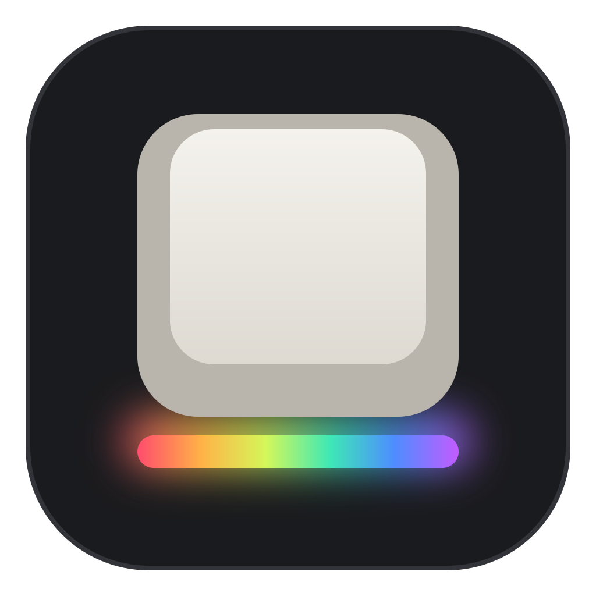
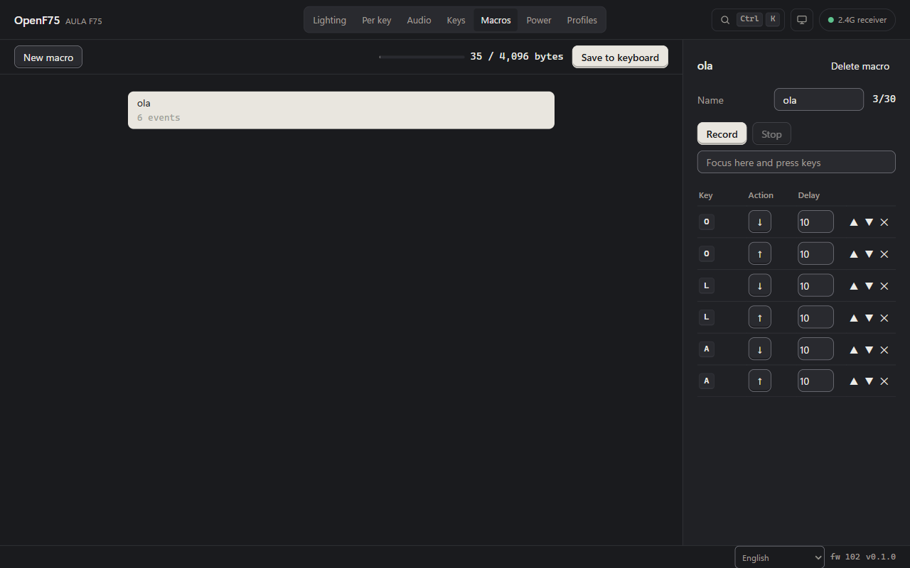

<div align="center">



# OpenF75

**Configurateur open source pour le clavier AULA F75.**<br>
Éclairage, couleurs par touche, remappage, macros et profils, sans le logiciel du fabricant.

[](https://github.com/pendiego/openf75/releases/latest)


[](#licence)

[**Télécharger**](https://github.com/pendiego/openf75/releases/latest) · [Fonctionnalités](#fonctionnalités) · [Installation](#installation) · [CLI](#ligne-de-commande) · [Limitations](#limitations)

[English](README.md) · [Português](README.pt-BR.md) · [Español](README.es.md) · **Français** · [Deutsch](README.de.md) · [日本語](README.ja.md) · [简体中文](README.zh-CN.md)

<br>


</div>

## Fonctionnalités

| Fonctionnalité | Ce qu'elle fait |
|---|---|
| **Éclairage** | Les 20 effets du clavier avec aperçu en direct sur un modèle 3D, luminosité, vitesse et couleur |
| **Par touche** | Peignez les touches une à une ou par zone et enregistrez-les sur le clavier |
| **Audio réactif** | Les touches deviennent un égaliseur du son diffusé par l'ordinateur |
| **Touches** | Remappez les couches Base et Fn : touches, multimédia, macros ou désactivation |
| **Macros** | Enregistrez des séquences avec un délai par événement, directement dans la mémoire du clavier |
| **Énergie** | Délai de veille, debounce et fonction de la molette (volume ou éclairage) |
| **Profils** | Enregistrez, appliquez, importez et exportez des configurations ; sauvegarde automatique à la première connexion |
| **Palette de commandes** | <kbd>Ctrl</kbd> <kbd>K</kbd> (<kbd>⌘</kbd> <kbd>K</kbd> sous macOS) pour aller à n'importe quel onglet ou action |

Thème clair et sombre, et mise à jour automatique.

<table>
  <tr>
    <td></td>
    <td></td>
  </tr>
  <tr>
    <td align="center"><sub>Remappage des couches</sub></td>
    <td align="center"><sub>Éditeur de macros</sub></td>
  </tr>
</table>

### Langues (en cours de développement)

L'interface de l'application sera disponible en portugais (Brésil), anglais, espagnol, français, allemand, japonais et chinois simplifié dans la prochaine version. Au premier lancement, l'application suivra la langue du système et passera à l'anglais si celle-ci ne figure pas dans la liste. Pour la changer, utilisez le sélecteur dans la barre d'état en bas de la fenêtre, à côté du firmware et de la version, ou recherchez la langue dans la palette de commandes ; le choix sera conservé.

La CLI et les messages d'erreur Rust resteront rédigés en portugais ; l'application affichera les erreurs connues dans la langue choisie.

### Compatibilité

| | Câble USB `258A:010C` | Récepteur 2.4 GHz `3554:FA09` | Bluetooth |
|---|:---:|:---:|:---:|
| AULA F75 | ✅ | ✅ | ❌ |
| AULA F75 KR | ❌ | ❌ | ❌ |

| Système | Paquet | État |
|---|---|---|
| Windows 10/11 | Installeur NSIS | Testé avec le clavier |
| Linux (x64) | `.deb` et AppImage | Validation CI en attente, sans test sur le matériel |
| macOS 13+ (Intel et Apple Silicon) | `.dmg` | Validation CI en attente, sans test sur le matériel |

## Installation

Téléchargez le paquet de votre système sur la [page des releases](https://github.com/pendiego/openf75/releases/latest).

> [!IMPORTANT]
> Sous Windows, **fermez le logiciel AULA (`OemDrv.exe`)** avant d'enregistrer : les deux se disputent la même interface du clavier. OpenF75 signale lorsqu'il est ouvert.

<details>
<summary><b>Windows</b></summary>

Lancez l'installeur. Aucun pilote ni règle supplémentaire n'est nécessaire. L'application se met à jour toute seule.

</details>

<details>
<summary><b>Linux</b></summary>

- **`.deb`** : installe la règle udev qui libère le clavier pour l'utilisateur connecté. Pour mettre à jour, installez le nouveau `.deb`.
- **AppImage** : se met à jour toute seule, mais la règle udev n'est pas incluse. Installez-la une fois :

  ```sh
  sudo cp packaging/linux/70-openf75.rules /etc/udev/rules.d/
  sudo udevadm control --reload && sudo udevadm trigger
  ```

La règle utilise `TAG+="uaccess"`, qui dépend de systemd-logind. Si l'application ne parvient pas à ouvrir le clavier, le message d'erreur y fait référence.

L'audio réactif capture le moniteur de la sortie par défaut (PulseAudio ou PipeWire).

</details>

<details>
<summary><b>macOS</b></summary>

L'application est signée ad hoc et n'est pas notarisée (il n'y a pas de certificat Apple). La première fois, faites un clic droit sur l'application et choisissez **Ouvrir**. Si macOS la bloque toujours :

```sh
xattr -dr com.apple.quarantine /Applications/OpenF75.app
```

macOS n'autorise pas les applications à capturer le son du système. Pour l'audio réactif, installez un périphérique de loopback comme [BlackHole](https://github.com/ExistentialAudio/BlackHole) et envoyez la sortie vers lui. macOS demandera l'autorisation du microphone : c'est par là que l'application lit le loopback.

</details>

Les macros, profils et sauvegardes se trouvent dans :

| Windows | macOS | Linux |
|---|---|---|
| `%APPDATA%\openf75\` | `~/Library/Application Support/openf75/` | `$XDG_CONFIG_HOME/openf75/` ou `~/.config/openf75/` |

## Ligne de commande

La CLI `openf75` fait la même chose que l'application, dans des scripts. Elle nécessite un Rust stable ; sous Linux, installez au préalable `libudev-dev`, `libasound2-dev` et `pkg-config`.

```sh
cargo install --path crates/openf75-cli   # installe la commande openf75 dans le PATH

openf75 status                                   # lecture seule
openf75 dump --out backup.json                   # lecture seule : à faire avant d'écrire
openf75 effect 2 --brightness 5 --speed 3 --rgb 00FF00
openf75 perkey --all 000000 W=FF0000 A=FF0000
openf75 remap base CapsLock key:0x29
openf75 macro-text F12 "ola"
openf75 sleep 300
openf75 debounce 1
openf75 restore backup.json
```

## Développement

```sh
cd app
npm install
npm run tauri dev            # application en mode dev
npm run check                # svelte-check
cargo test -p openf75        # tests du protocole
```

Build de l'installeur : `npm run tauri build` sous Windows ; sous Linux, ajoutez `-- --bundles deb,appimage` ; sous macOS, `-- --target universal-apple-darwin --bundles app,dmg`.

| Chemin | Contenu |
|---|---|
| [`crates/openf75`](crates/openf75) | Bibliothèque Rust : protocole HID, périphérique, audio, fichiers |
| [`crates/openf75-cli`](crates/openf75-cli) | CLI `openf75` |
| [`app/`](app) | Application de bureau (Tauri 2 + Svelte 5) |
| [`docs/PROTOCOL.md`](docs/PROTOCOL.md) | Protocole du F75, retrouvé par rétro-ingénierie |

<details>
<summary><b>Publier une version</b></summary>

1. Augmentez `version` dans `app/src-tauri/tauri.conf.json`, `app/src-tauri/Cargo.toml` et `app/package.json` ; mettez à jour `app/package-lock.json` (`npm install --package-lock-only` dans `app/`) et `Cargo.lock` (`cargo check -p app`).
2. Faites le commit, créez le tag et poussez-le : `git tag vX.Y.Z` puis `git push origin vX.Y.Z`.
3. Le workflow [`release.yml`](.github/workflows/release.yml) compile sur `windows-latest`, `ubuntu-22.04` et `macos-latest`, un à la fois (`max-parallel: 1`), car `tauri-action` fusionne le `latest.json` lu par l'updater.

L'application recherche une nouvelle version à l'ouverture et affiche le bouton **Mettre à jour**. La mise à jour est vérifiée par la signature de l'updater. Sous Linux, seule l'AppImage se met à jour toute seule.

Secrets du dépôt (Settings → Secrets and variables → Actions) :
- `TAURI_SIGNING_PRIVATE_KEY` : contenu de `%USERPROFILE%\.tauri\openf75.key`.
- `TAURI_SIGNING_PRIVATE_KEY_PASSWORD` : contenu de `%USERPROFILE%\.tauri\openf75.key.password`.

> [!CAUTION]
> La clé privée n'entre jamais dans le dépôt. Si elle est perdue, les applications installées n'acceptent plus les mises à jour : il faudra réinstaller à la main et remplacer le `pubkey` de `tauri.conf.json`.

</details>

## Limitations

**Clavier et connexion**

- **AULA F75 uniquement.** Le F75 KR (disposition différente) et le Bluetooth ne sont pas pris en charge.
- **Câble USB :** le protocole a été implémenté à partir de la rétro-ingénierie et n'a que des tests unitaires ; il n'a jamais été testé avec le clavier.
- **Récepteur 2.4 GHz :**
  - La palette de couleurs (`0x49`) ne répond pas : la couleur affichée est la couleur par défaut, les sauvegardes n'incluent pas la palette, la restauration l'ignore et les couleurs personnalisées sont refusées (utilisez les slots 0-6 ou le câble).
  - Les modes réactifs à l'audio et en temps réel tournent à environ 3 fps.
  - Une couche de touches arrive avec 504 de ses 512 octets ; le reste est rempli de zéros.
  - La première réponse peut prendre environ 400 ms.
  - Les écritures échouent quand le clavier est en veille ou éteint ; pressez une touche pour le réveiller.
- **Délai de veille :** il ne s'applique qu'en mode sans fil.
- **Molette :** l'octet qui choisit le volume ou l'éclairage a été trouvé via le récepteur ; il n'a pas été confirmé par câble.
- **Firmware :** OpenF75 ne met pas à jour le firmware. Le pilote d'AULA non plus : il appelle un outil de mise à jour externe absent du paquet F75 actuel.
- **Macros :** 4096 octets au total, noms compris ; noms jusqu'à 30 caractères ; délais jusqu'à 1 048 575 ms (environ 17 min) par événement.

**Systèmes**

- **Windows :** fermez le logiciel AULA (`OemDrv.exe`) avant d'écrire. Seul un installateur NSIS x64 est fourni.
- **Linux et macOS n'ont pas été testés avec le clavier,** et les paquets n'ont pas encore passé la CI. Exécutez `openf75 status` et `openf75 dump` avant d'écrire quoi que ce soit sur ces systèmes.
- **Linux :** x64 uniquement. L'accès au clavier dépend de la règle udev, qui utilise `TAG+="uaccess"` et nécessite systemd-logind ; l'AppImage n'installe pas la règle. Seul l'AppImage se met à jour automatiquement ; le `.deb` se met à jour à la main. Le mode réactif à l'audio nécessite PulseAudio ou PipeWire.
- **macOS :** version 13 ou ultérieure uniquement. L'application n'est pas notariée, donc Gatekeeper bloque le premier lancement. Le système n'autorise pas la capture de son : le mode réactif à l'audio nécessite un périphérique de bouclage (BlackHole et similaires) et l'autorisation du microphone.

**Langue**

- Les traductions de l'interface sont encore en cours de développement. La CLI et les messages d'erreur venant de Rust sont en portugais ; l'application ne traduit que les erreurs qu'elle connaît.

## Licence

[MIT](LICENSE). Projet indépendant, sans affiliation avec AULA. Aucun fichier du fabricant ne fait partie du dépôt.
