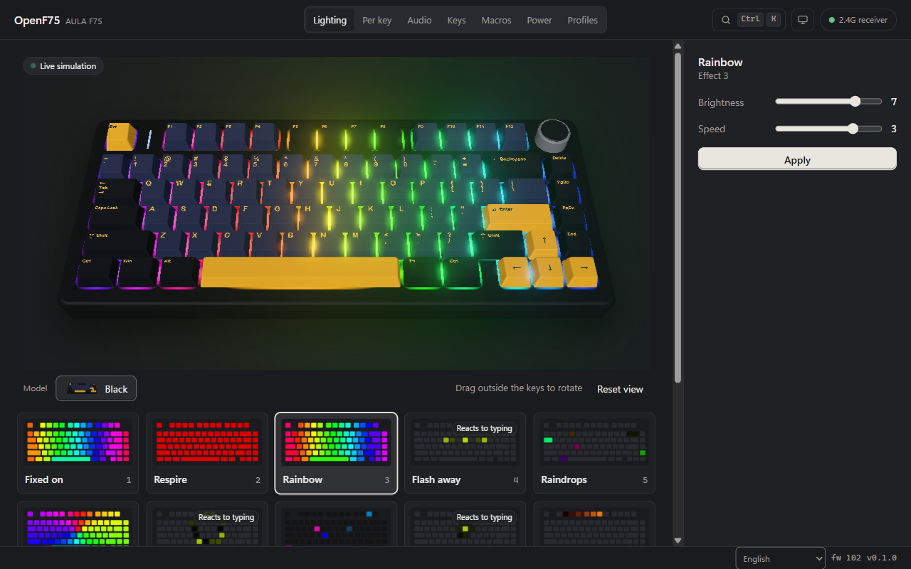
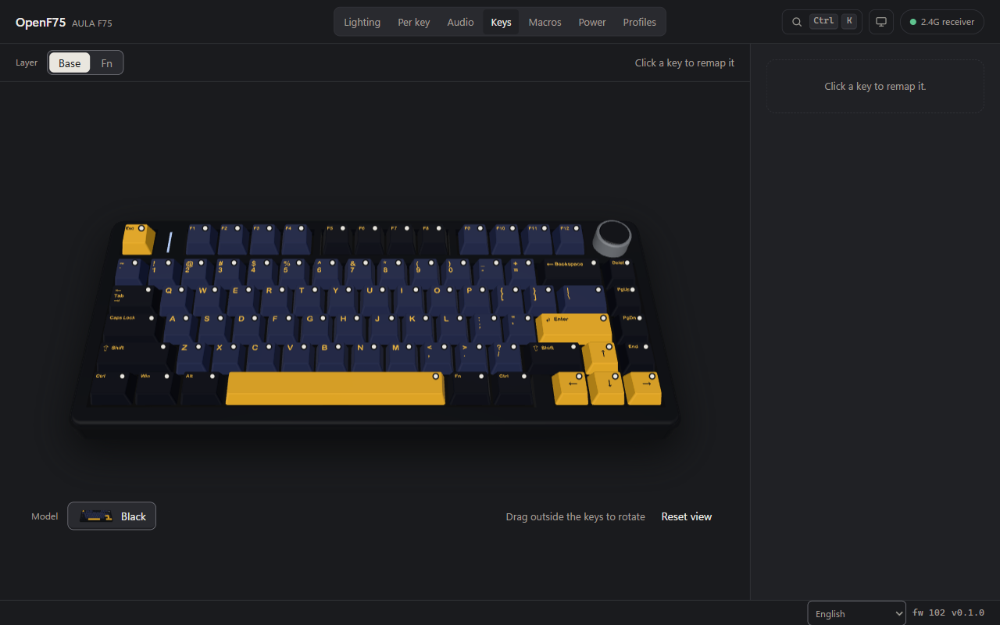

<div align="center">


# OpenF75

**Configurador open source para o teclado AULA F75.**<br>
Iluminação, cores por tecla, remapeamento, macros e perfis, sem o software da fabricante.

[](https://github.com/pendiego/openf75/releases/latest)


[](#licença)

[**Baixar**](https://github.com/pendiego/openf75/releases/latest) · [Recursos](#recursos) · [Instalação](#instalação) · [CLI](#linha-de-comando) · [Limitações](#limitações)

[English](README.md) · **Português** · [Español](README.es.md) · [Français](README.fr.md) · [Deutsch](README.de.md) · [日本語](README.ja.md) · [简体中文](README.zh-CN.md)

<br>



</div>

## Recursos

| Recurso | O que faz |
|---|---|
| **Iluminação** | Os 20 efeitos do teclado com prévia ao vivo num modelo 3D, brilho, velocidade e cor |
| **Por tecla** | Pinte as teclas uma a uma ou em área e grave no teclado |
| **Áudio reativo** | As teclas viram um equalizador do som que está tocando no computador |
| **Teclas** | Remapeie as camadas Base e Fn: teclas, mídia, macros ou desativar |
| **Macros** | Grave sequências com atraso por evento, direto na memória do teclado |
| **Energia** | Tempo de sleep, debounce e função da rodinha (volume ou iluminação) |
| **Perfis** | Salve, aplique, importe e exporte configurações; backup automático na primeira conexão |
| **Paleta de comandos** | <kbd>Ctrl</kbd> <kbd>K</kbd> (<kbd>⌘</kbd> <kbd>K</kbd> no macOS) para ir a qualquer aba ou ação |

Tema claro e escuro e atualização automática.

<table>
  <tr>
    <td></td>
    <td></td>
  </tr>
  <tr>
    <td align="center"><sub>Remapeamento das camadas</sub></td>
    <td align="center"><sub>Editor de macros</sub></td>
  </tr>
</table>

### Idiomas (em desenvolvimento)

A interface do app vai ganhar tradução para português (Brasil), inglês, espanhol, francês, alemão, japonês e chinês simplificado na próxima versão, que está em desenvolvimento. Na primeira abertura o app vai seguir o idioma do sistema e cair para o inglês quando ele não estiver na lista. Para trocar, vai haver um seletor na barra de status, no canto inferior da janela (ao lado da versão do firmware), e também a paleta de comandos; a escolha ficará salva.

A CLI e as mensagens de erro do Rust continuam em português; o app vai mostrar os erros conhecidos no idioma escolhido.

### Compatibilidade

| | Cabo USB `258A:010C` | Receptor 2.4 GHz `3554:FA09` | Bluetooth |
|---|:---:|:---:|:---:|
| AULA F75 | ✅ | ✅ | ❌ |
| AULA F75 KR | ❌ | ❌ | ❌ |

| Sistema | Pacote | Estado |
|---|---|---|
| Windows 10/11 | Instalador NSIS | Testado com o teclado |
| Linux (x64) | `.deb` e AppImage | Validação no CI pendente, sem teste em hardware |
| macOS 13+ (Intel e Apple Silicon) | `.dmg` | Validação no CI pendente, sem teste em hardware |

## Instalação

Baixe o pacote do seu sistema na [página de releases](https://github.com/pendiego/openf75/releases/latest).

> [!IMPORTANT]
> No Windows, **feche o software da AULA (`OemDrv.exe`)** antes de gravar: os dois disputam a mesma interface do teclado. O OpenF75 avisa quando ele está aberto.

<details>
<summary><b>Windows</b></summary>

Rode o instalador. Não há driver nem regra extra. O app se atualiza sozinho.

</details>

<details>
<summary><b>Linux</b></summary>

- **`.deb`**: instala a regra udev que libera o teclado para o usuário logado. Para atualizar, instale o `.deb` novo.
- **AppImage**: se atualiza sozinho, mas a regra udev não vem junto. Instale-a uma vez:

  ```sh
  sudo cp packaging/linux/70-openf75.rules /etc/udev/rules.d/
  sudo udevadm control --reload && sudo udevadm trigger
  ```

A regra usa `TAG+="uaccess"`, que depende do systemd-logind. Se o app não conseguir abrir o teclado, a mensagem de erro aponta para ela.

O áudio reativo captura o monitor da saída padrão (PulseAudio ou PipeWire).

</details>

<details>
<summary><b>macOS</b></summary>

O app tem assinatura ad-hoc e não é notarizado (não há certificado da Apple). Na primeira vez, clique com o botão direito no app e escolha **Abrir**. Se o macOS continuar bloqueando:

```sh
xattr -dr com.apple.quarantine /Applications/OpenF75.app
```

O macOS não deixa apps capturarem o som do sistema. Para o áudio reativo, instale um dispositivo de loopback como o [BlackHole](https://github.com/ExistentialAudio/BlackHole) e mande a saída para ele. O macOS vai pedir permissão de microfone: é por ali que o app lê o loopback.

</details>

Macros, perfis e backups ficam em:

| Windows | macOS | Linux |
|---|---|---|
| `%APPDATA%\openf75\` | `~/Library/Application Support/openf75/` | `$XDG_CONFIG_HOME/openf75/` ou `~/.config/openf75/` |

## Linha de comando

A CLI `openf75` faz o mesmo que o app, em scripts. Precisa de Rust estável; no Linux instale antes `libudev-dev`, `libasound2-dev` e `pkg-config`.

```sh
cargo install --path crates/openf75-cli   # instala o comando openf75 no PATH

openf75 status                                   # só leitura
openf75 dump --out backup.json                   # só leitura: faça antes de gravar
openf75 effect 2 --brightness 5 --speed 3 --rgb 00FF00
openf75 perkey --all 000000 W=FF0000 A=FF0000
openf75 remap base CapsLock key:0x29
openf75 macro-text F12 "ola"
openf75 sleep 300
openf75 debounce 1
openf75 restore backup.json
```

## Desenvolvimento

```sh
cd app
npm install
npm run tauri dev            # app em modo dev
npm run check                # svelte-check
cargo test -p openf75        # testes do protocolo
```

Build do instalador: `npm run tauri build` no Windows; no Linux acrescente `-- --bundles deb,appimage`; no macOS, `-- --target universal-apple-darwin --bundles app,dmg`.

| Caminho | Conteúdo |
|---|---|
| [`crates/openf75`](crates/openf75) | Biblioteca Rust: protocolo HID, dispositivo, áudio, arquivos |
| [`crates/openf75-cli`](crates/openf75-cli) | CLI `openf75` |
| [`app/`](app) | App desktop (Tauri 2 + Svelte 5) |
| [`docs/PROTOCOL.md`](docs/PROTOCOL.md) | Protocolo do F75, recuperado por engenharia reversa |

<details>
<summary><b>Publicar uma versão</b></summary>

1. Aumente `version` em `app/src-tauri/tauri.conf.json`, `app/src-tauri/Cargo.toml` e `app/package.json`; atualize `app/package-lock.json` (`npm install --package-lock-only` em `app/`) e `Cargo.lock` (`cargo check -p app`).
2. Faça o commit, crie a tag e envie: `git tag vX.Y.Z` e `git push origin vX.Y.Z`.
3. O workflow [`release.yml`](.github/workflows/release.yml) compila em `windows-latest`, `ubuntu-22.04` e `macos-latest`, um por vez (`max-parallel: 1`), porque o `tauri-action` mescla o `latest.json` que o atualizador lê.

O app procura uma versão nova ao abrir e mostra o botão **Atualizar**. A atualização é conferida pela assinatura do updater. No Linux, só o AppImage se atualiza sozinho.

Segredos do repositório (Settings → Secrets and variables → Actions):
- `TAURI_SIGNING_PRIVATE_KEY`: conteúdo de `%USERPROFILE%\.tauri\openf75.key`.
- `TAURI_SIGNING_PRIVATE_KEY_PASSWORD`: conteúdo de `%USERPROFILE%\.tauri\openf75.key.password`.

> [!CAUTION]
> A chave privada nunca entra no repositório. Se ela for perdida, os apps instalados deixam de aceitar atualizações: será preciso reinstalar à mão e trocar o `pubkey` de `tauri.conf.json`.

</details>

## Limitações

**Teclado e conexão**

- **Só o AULA F75.** O F75 KR (layout diferente) e o Bluetooth não são suportados.
- **Cabo USB:** o protocolo foi implementado a partir da engenharia reversa e só tem teste unitário; nunca foi exercitado com o teclado.
- **Receptor 2.4 GHz:**
  - A paleta de cores (`0x49`) não responde: a cor exibida é a padrão, o backup não inclui a paleta, o restore pula a paleta e cor personalizada é recusada (use os slots 0-6 ou o cabo).
  - Áudio reativo e tempo real rodam a cerca de 3 fps.
  - Uma camada de teclas chega com 504 dos 512 bytes; o resto é preenchido com zeros.
  - A primeira resposta pode levar cerca de 400 ms.
  - Gravar falha com o teclado dormindo ou desligado; aperte uma tecla para acordá-lo.
- **Tempo de sleep:** só vale no modo sem fio.
- **Rodinha:** o byte que escolhe volume ou iluminação foi descoberto pelo receptor; pelo cabo não foi confirmado.
- **Firmware:** o OpenF75 não atualiza firmware. O driver da AULA também não grava: ele chama um atualizador externo que não vem no pacote atual do F75.
- **Macros:** 4096 bytes no total, contando os nomes; nome com até 30 caracteres; atraso de até 1.048.575 ms (cerca de 17 min) por evento.

**Sistemas**

- **Windows:** feche o software da AULA (`OemDrv.exe`) antes de gravar. Só há instalador NSIS para x64.
- **Linux e macOS não foram testados com o teclado,** e os pacotes ainda não passaram pelo CI. Rode `openf75 status` e `openf75 dump` antes de gravar qualquer coisa nesses sistemas.
- **Linux:** só x64. O acesso ao teclado depende da regra udev, que usa `TAG+="uaccess"` e exige systemd-logind; o AppImage não instala a regra. Só o AppImage se atualiza sozinho; o `.deb` é atualizado à mão. O áudio reativo exige PulseAudio ou PipeWire.
- **macOS:** só 13 ou mais novo. O app não é notarizado, então o Gatekeeper bloqueia a primeira abertura. O sistema não deixa capturar o som: o áudio reativo exige um dispositivo de loopback (BlackHole e similares) e permissão de microfone.

**Idioma**

- As traduções da interface ainda estão em desenvolvimento. A CLI e as mensagens de erro vindas do Rust são em português; o app traduz só os erros que conhece.

## Licença

[MIT](LICENSE). Projeto independente, sem afiliação com a AULA. Nenhum arquivo da fabricante faz parte do repositório.
